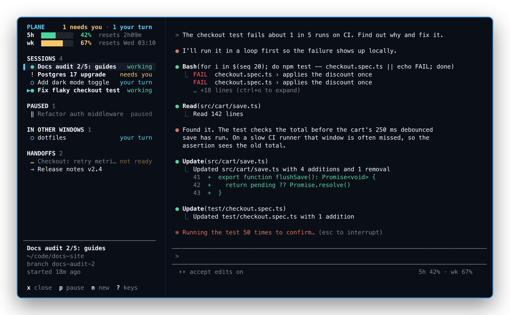
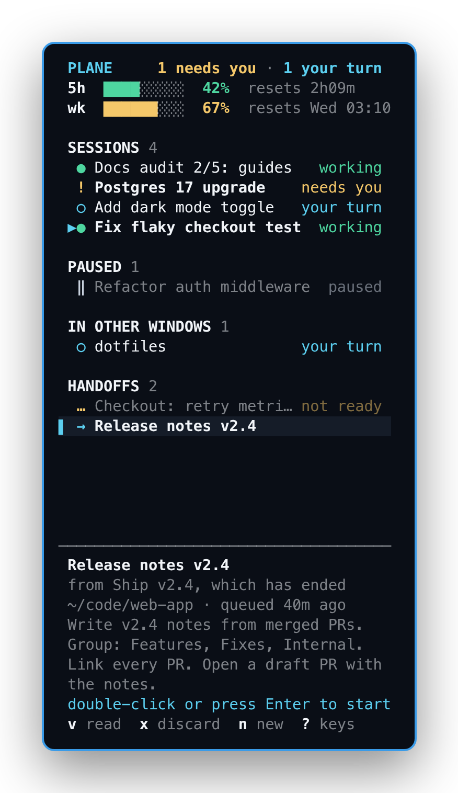
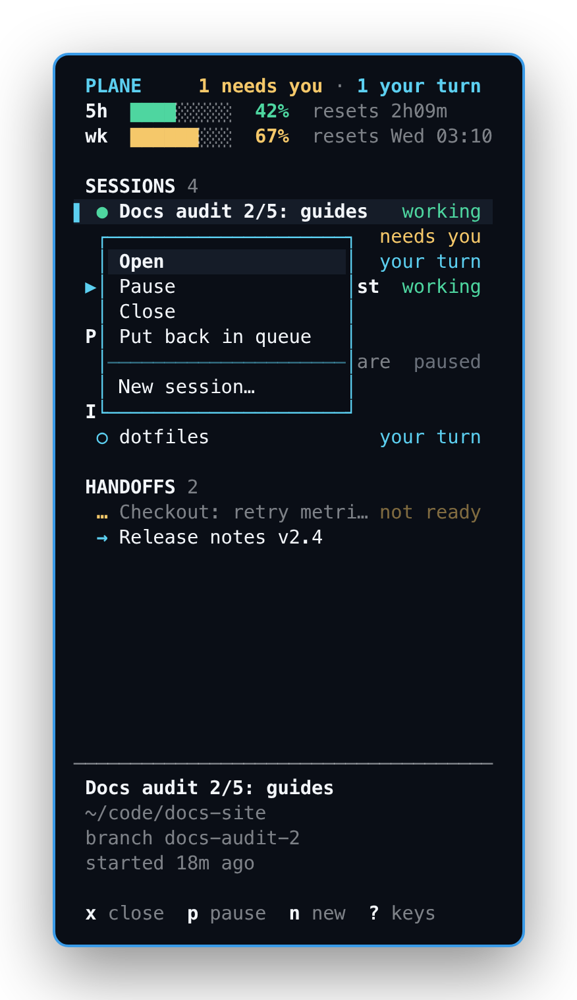
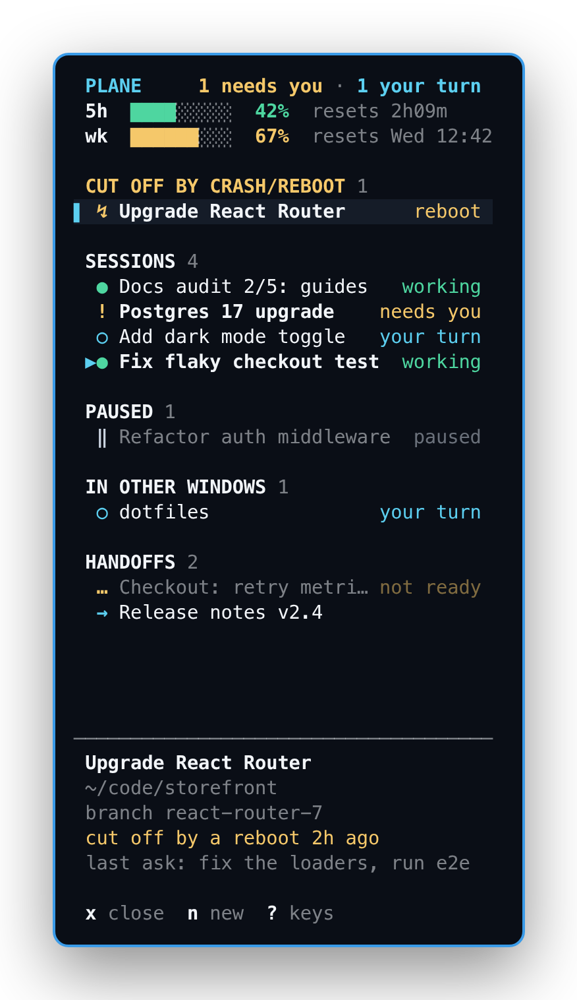

<p align="center">
  
</p>

<h1 align="center">Plane</h1>

<p align="center">
  One terminal window for all your Claude Code sessions.<br>
  A sidebar of every session on the left, the one you picked on the right.
</p>

<p align="center">
  
</p>

If you run several [Claude Code](https://claude.com/claude-code) sessions at once, they end
up scattered across terminal tabs and windows, and it's easy to lose track of which one is
working, which one is waiting on you, and which one you forgot about. Plane keeps them all in
one [kitty](https://sw.kovidgoyal.net/kitty/) window:

- **See every session at a glance.** Each one shows whether it's *working*, *your turn* or
  *needs you* (blocked on a permission or a question).
- **Switch with a click.** The session opens in the right-hand pane as a real kitty window,
  so scrolling, copying and keys all work exactly as they do in kitty.
- **Sessions keep running when you look away.** They're Claude Code background sessions, so
  closing Plane, or switching to another session, doesn't stop them.
- **Queue handoffs.** When a long session should continue in a fresh one, it can write a
  handoff prompt into Plane's queue. Start it when you're ready.
- **Recover from crashes and reboots.** Sessions cut off mid-work are listed so you can
  resume them in one step, and you get a reminder at login.
- **Watch your usage.** Bars for the 5-hour and weekly limits, with reset times.

<table>
  <tr>
    <td width="33%"></td>
    <td width="33%"></td>
    <td width="33%"></td>
  </tr>
  <tr>
    <td align="center"><b>Handoffs</b> wait in a queue.<br>Double-click or Enter starts one.</td>
    <td align="center"><b>Right-click</b> any row for<br>everything you can do with it.</td>
    <td align="center"><b>Cut off</b> by a crash or reboot?<br>Resume it from the top.</td>
  </tr>
</table>

<sub>Screenshots use made-up demo data. See <a href="docs/screenshots/make.py">docs/screenshots/make.py</a>.</sub>

## Requirements

- **Linux**
- **Python 3** (standard library only, nothing to `pip install`; developed on 3.14)
- **[kitty](https://sw.kovidgoyal.net/kitty/)** terminal
- **[Claude Code](https://claude.com/claude-code)** with background sessions
  (`claude --bg`, `claude agents`, `claude attach`)
- Optional: **Hyprland**, to jump to sessions running in other windows and to move focus
  with Super+arrows. Everything else works on any desktop.
- Optional: **notify-send** (libnotify), for "handoff ready" and login reminders.

## Install

```sh
git clone https://github.com/Teepi1/plane.git
cd plane
./install.sh --claude --autostart
```

| Option        | What it adds |
|---------------|--------------|
| *(none)*      | `plane` in `~/.local/bin` (a symlink, so `git pull` updates it), the icon and an app-menu launcher |
| `--claude`    | Plane's status line and hooks in `~/.claude/settings.json` (backed up first; an existing status line is left alone) |
| `--autostart` | the recovery check at login |

Then open it from your app menu, or run `plane open`. It's best bound to a key, for example
in `hyprland.conf`:

```ini
bind = SUPER SHIFT, C, exec, plane open
```

## Using it

Click a session to open it. **n** starts a new one: pick a recent project folder, give it a
name and an optional first message. Right-click any row for all of its actions.

| Key | |
|-----|---|
| Click, Enter | open the selected session (handoffs need a double-click or Enter) |
| Right-click | every action for that row |
| ↑ ↓, j k | move the selection |
| n | new session |
| p | pause: the session stops but stays listed under PAUSED |
| x | close: the session ends and leaves the list (the conversation is kept, `claude --resume` finds it) |
| v | read a handoff's prompt |
| x on a handoff | discard it (kept in `handoffs/discarded/` for 14 days, then deleted) |
| r / R | refresh / reload Plane's own code in place |
| ? | all keys |
| q | quit Plane (sessions keep running) |

Drag the border between the sidebar and the session to make the sidebar wider or narrower.
It keeps that width until the Plane window itself changes size, for example going from
half the screen to full, and then goes back to its default.

Pasting into the sidebar sends the paste to the open session, so a misplaced paste can't
trigger sidebar keys.

### Sections

- **SESSIONS:** your running background sessions.
- **STANDBY:** sessions that were waiting on you when Claude Code put them to sleep (it does
  this to background sessions left idle for a while) or the machine restarted. Nothing was
  lost: open one and it picks up where it left off.
- **PAUSED:** sessions you paused. Open one to continue it.
- **IN OTHER WINDOWS:** Claude Code sessions running in ordinary terminals. Opening one
  switches to its window (on Hyprland).
- **HANDOFFS:** queued prompts waiting to start as new sessions.
- **CUT OFF BY CRASH/REBOOT:** sessions that were working when the machine went down.

## Handoffs

A handoff is a prompt one session writes so that a fresh session can pick up its work,
which is useful when a conversation has grown long and its answers are getting worse.
Queue one from anywhere:

```sh
plane handoff add --title "Release notes v2.4" --cwd ~/code/web-app <<'EOF'
Write the v2.4 release notes from the merged PRs ...
EOF
```

Plane notes which session queued it and marks the handoff *ready* once that session
stops working. Starting it opens a new session with the prompt as its first message.
If you start one by accident, right-click the new session and choose **Put back in
queue**.

[`skills/handoff/SKILL.md`](skills/handoff/SKILL.md) is a Claude Code skill that writes a
handoff and queues it for you. Copy it into `~/.claude/skills/handoff/` (or a project's
`.claude/skills/`) and type `/handoff` in a session.

## Usage bars

Claude Code passes your rate-limit usage to its status line command. `plane statusline`
records it for the sidebar and prints a short `5h 42% · wk 67%` status line. `--claude`
sets this up when you don't have a status line yet. If you already have one, give the
same input to both and keep your own output:

```json
"statusLine": {
  "type": "command",
  "command": "sh -c 'in=$(cat); printf %s \"$in\" | plane statusline >/dev/null; printf %s \"$in\" | your-statusline-command'"
}
```

## Crash and reboot recovery

With the hooks from `--claude`, every session keeps a small record in
`~/.local/share/plane/live/` while it runs, and marks it when it ends normally. A session
whose record is still open after its process is gone was cut off, so Plane lists it at
the top of the sidebar, and Enter resumes it. A background session that was waiting on you
rather than working goes under STANDBY instead, since nothing was interrupted. With `--autostart`, a notification at login
lists anything that was cut off plus handoffs still waiting.

## Hyprland

Plane works on any desktop. On Hyprland it can also:

- **jump to sessions in other windows** (IN OTHER WINDOWS, Enter), and
- **move focus with Super+arrows**: inside Plane they move between the sidebar and the
  session, and past its edge, or in any other window, they move focus as usual.

```ini
bind = SUPER SHIFT, C, exec, plane open
bind = SUPER, left,  exec, plane focus left
bind = SUPER, right, exec, plane focus right
bind = SUPER, up,    exec, plane focus up
bind = SUPER, down,  exec, plane focus down
```

To have it open maximized, add a window rule for the class `plane`. Both Hyprland's Lua
dispatchers (0.56+) and the classic ones are supported.

## How it works

`plane` is a single Python script. `plane open` starts kitty with class `plane`, a
splits layout and remote control on a private socket. The left window runs the
`plane sidebar` curses UI, and the right window is `claude attach <id>` for the open
session, swapped out with `kitty @ launch` whenever you pick another one.

| Path | What's there |
|------|--------------|
| `~/.local/share/plane/handoffs/` | queued handoffs; started ones move to `done/` |
| `~/.local/share/plane/live/` | the running-session records used for crash recovery |
| `~/.cache/plane/usage.json` | the latest usage numbers from the status line |

Session data comes from `claude agents --json --all`. Plane only reads Claude Code's own
files. The one exception is `install.sh --claude`, which adds to `settings.json`.

Troubleshooting: run with `PLANE_DEBUG=1 plane open` to log events to
`~/.cache/plane/debug.log`.

## Make it your own

Fork it and change whatever you like. That's what the MIT license is for. Pull requests
are welcome too, though I may not merge every one.

To regenerate the screenshots after changing the UI:

```sh
python3 -m venv /tmp/shotenv && /tmp/shotenv/bin/pip install pyte
/tmp/shotenv/bin/python docs/screenshots/make.py   # needs Chrome or Chromium
```

## License

[MIT](LICENSE)
